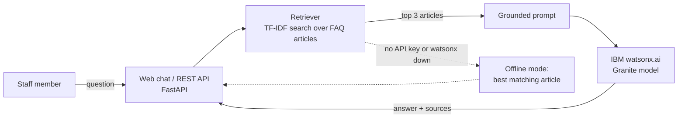

# watsonx EHR Support Assistant


An AI support assistant that answers **how-to questions from hospital staff** about their electronic health record (EHR) system, using **IBM watsonx.ai** and Retrieval-Augmented Generation (RAG).

## The business problem

During an EHR go-live, hundreds of clinicians and clerks learn a new system at once. Most of their questions repeat: *"I'm locked out," "How do I reschedule?", "I registered a patient twice."* Each one takes time from at-the-elbow (ATE) support staff and the Service Desk.

This assistant answers those common questions instantly, 24/7, using the organization's own approved support articles. Support staff can then focus on complex issues.

**Value for a client:**
- Faster answers for end users, so less time away from patients
- Fewer repeat Service Desk tickets during go-live
- Consistent answers, because the AI may only use approved articles
- Each answer shows its source article, so staff can trust and check it

> I built this from my experience delivering ATE go-live support for a province-wide Oracle Health (Cerner) EHR rollout at Nova Scotia Health. The FAQ articles here are generic samples I wrote, not any organization's real content.

## How it works



1. **Retrieve.** The question is matched against the support articles using TF-IDF and cosine similarity.
2. **Ground.** The top 3 articles go into a prompt that tells the model to use *only* those articles, keep answers short, and never ask for passwords or patient information.
3. **Generate.** IBM watsonx.ai (`ibm/granite-3-8b-instruct` by default) writes a plain-language answer.
4. **Fall back safely.** With no API key, or if watsonx.ai is unreachable, the app returns the best matching article, so it never leaves a user without an answer.

## Tech stack

| Area | Tools |
|---|---|
| AI | IBM watsonx.ai (REST API, IAM authentication), IBM Granite model, RAG |
| Back end | Python 3.12, FastAPI, Pydantic |
| Front end | HTML, CSS, JavaScript chat page |
| Testing | pytest (25 tests), mocked watsonx.ai calls |
| DevOps | Docker, GitHub Actions CI (tests + Docker build on every push) |

## Run it locally

```bash
git clone https://github.com/mukhialshifa-max/watsonx-ehr-support-assistant.git
cd watsonx-ehr-support-assistant
python -m venv .venv
source .venv/bin/activate        # Windows: .venv\Scripts\activate
pip install -r requirements-dev.txt
uvicorn app.main:app --reload
```

Open http://localhost:8000. Without credentials it runs in **offline mode**.

### Connect IBM watsonx.ai (free trial)

1. Create a free IBM Cloud account and open **watsonx.ai**.
2. Create a project. Copy its **Project ID** from *Manage → General*.
3. Associate a **watsonx.ai Runtime** service with the project.
4. Create an **IBM Cloud API key** (*Manage → Access (IAM) → API keys*).
5. Copy `.env.example` to `.env` and fill in `WATSONX_API_KEY` and `WATSONX_PROJECT_ID`. Change `WATSONX_URL` if your project is not in Dallas (`us-south`); for Toronto use `https://ca-tor.ml.cloud.ibm.com`.
6. Restart the app. The footer will show **Engine: IBM watsonx.ai**.

`.env` is in `.gitignore`, so your key is never committed.

### Run with Docker

```bash
docker build -t watsonx-ehr-support-assistant .
docker run -p 8080:8080 --env-file .env watsonx-ehr-support-assistant
```

## API

| Method | Path | Description |
|---|---|---|
| `POST` | `/ask` | `{"question": "..."}` returns `answer`, `sources`, `engine` |
| `GET` | `/health` | Status, engine in use, number of articles |
| `GET` | `/categories` | Support article categories |
| `GET` | `/docs` | Interactive API docs (Swagger) |

Example:

```bash
curl -X POST http://localhost:8000/ask -H "Content-Type: application/json" \
  -d '{"question": "My labels are not printing"}'
```

## Run the tests

```bash
pytest -v
```

Tests cover retrieval accuracy, prompt grounding, the watsonx.ai IAM and generation calls (mocked), token reuse, input validation and the offline fallback.

## Project structure

```
app/
  main.py            FastAPI app and API endpoints
  knowledge_base.py  Loads articles and runs TF-IDF retrieval
  llm.py             watsonx.ai client, grounded prompt, offline mode
  static/index.html  Chat page
data/faq.json        Sample support articles (edit to add your own)
tests/               pytest suite
.github/workflows/   CI pipeline
```

## How I built it

I wrote the specification first: the business problem, the API, the safety rules for the prompt, and the fallback behaviour. I then used **Claude** as an AI code assistant to generate the code from that spec. I reviewed every file, ran the tests, and tested the app with real support questions from my go-live experience.

## Next steps

- Deploy on **IBM Cloud Code Engine** using the included Dockerfile
- Replace TF-IDF with watsonx.ai embeddings and a vector store
- Add a "Was this helpful?" button to find gaps in the articles
- Add French answers for bilingual sites

## Author

**Alshifa Mukhi** · [LinkedIn](https://www.linkedin.com/in/alshifa-mukhi-623909304) · [GitHub](https://github.com/mukhialshifa-max)
